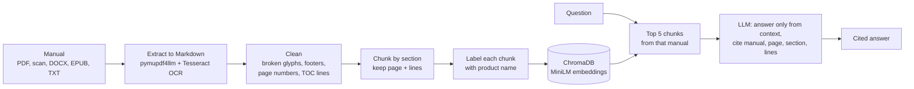
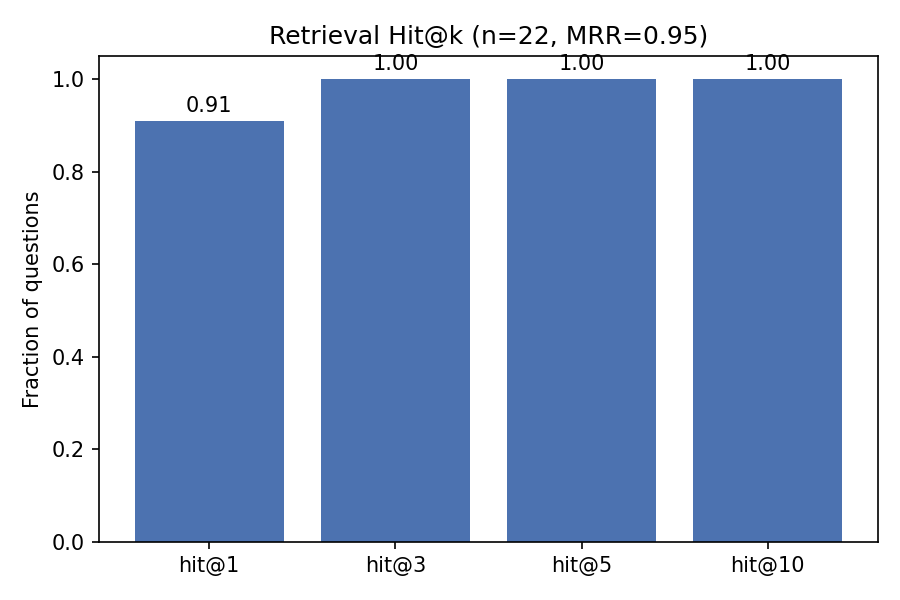
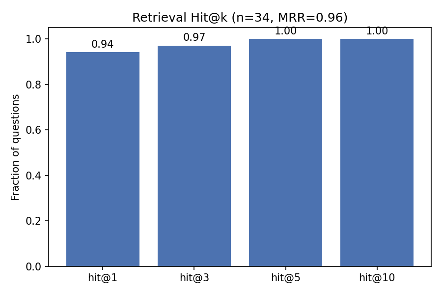

# Manual RAG Assistant

**Upload an instruction manual, ask a question in plain English, and get the answer with the exact page, section and lines it came from. No need to read the whole manual.**


---

## Demo

Real output for the GE JVM3160 microwave manual (46 pages, English and Spanish):

```
$ python main.py ask "One of the lights below the oven is not working. How do I make it work?" \
      --file data/raw/ge_microwave_jvm3160.pdf

Using: ge_microwave_jvm3160.pdf (GE JVM3160 Microwave Oven)

**Answer:** To restore the light below the oven, replace the cooktop light/nite light bulb.
The manual specifies a 120 volt, 50 watt (max.) halogen bulb.

**Location in Manual:**
- Manual: ge_microwave_jvm3160.pdf (GE JVM3160 Microwave Oven)
- Page: 17
- Section: Cooktop Light/Nite Light
- Lines: 5-13

**Steps:**
1. Disconnect the power at the main fuse or circuit breaker panel, or pull the plug.
2. Remove the screw from the side of the light compartment cover and lower the cover until it stops.
3. Be sure the bulb is cool before removing. Break the adhesive seal by gently unscrewing the bulb.
4. Screw in the new bulb, then raise the light cover and replace the screw. Connect electrical power to the oven.
```

The question never says "cooktop", "nite light" or "bulb". Retrieval works on meaning, so it still ranks the right section first.

And when the manual doesn't have the answer, it says so instead of inventing one:

```
$ python main.py ask "How do I connect this microwave to WiFi?"
The manual does not cover this.
```

## Two modes: today and the enterprise path

| | Mode 1: Ad hoc (built and verified) | Mode 2: Library (designed for, partly built) |
|---|---|---|
| Use case | One person, one manual, answers right now | A team with ~200 domain PDFs (manuals, SOPs, service guides) |
| How documents get in | Upload in the web app, or `--file` on the CLI | Bulk ingest a folder: `ingest --path docs/` |
| What gets searched | Only that manual | The whole library, or filtered by manual |
| Limits | 50 pages, text based (keeps the demo fast and cheap) | No page limit for curated ingestion |
| Status | ✅ Working end to end | ✅ Folder ingest, incremental re-indexing, per-manual citations, cross-manual evaluation. See the roadmap for what scale needs. |

## How it works



1. **Extract.** Each page becomes Markdown with `pymupdf4llm`. Scanned pages and pages with broken fonts are OCR'd with Tesseract.
2. **Clean.** Remove undecodable glyphs, markup, repeated footers, page numbers and table of contents lines. These are detected generically, so nothing is hardcoded per manual.
3. **Chunk by structure.** A new chunk starts at each heading, so numbered steps stay together. Every chunk keeps its page, section and line range, which is what makes exact citations possible.
4. **Label every chunk with its product.** At upload, the LLM reads the first pages once and names the product (e.g. "MR. Coffee 4-cup CoffeeMaker"). That name is prefixed to every chunk before embedding (contextual retrieval).
5. **Retrieve.** `all-MiniLM-L6-v2` embeddings in a persistent ChromaDB collection. Unchanged files are skipped on re-ingest using a file hash.
6. **Answer.** The top 5 chunks go to `nvidia/nemotron-3.5-lightning-30b-a3b` (via NVIDIA NIM, with a fallback model). The prompt requires answers only from the context, real citations, steps only when the manual gives steps, and a one sentence refusal when the answer isn't there.

## Results

Retrieval evaluated on **34 hand labelled questions** across **2 manuals** (GE microwave, Mr. Coffee coffeemaker), in two modes:

| Metric | Within the question's manual | Across all manuals (right manual + page) |
|---|---|---|
| Hit@1 | **0.94** | **0.94** |
| Hit@3 | 0.97 | 0.97 |
| Hit@5 | **1.00** | **1.00** |
| MRR | **0.96** | **0.96** |

Hit@5 = 1.00 means the right page was always among the 5 chunks the LLM reads.




**Answer behaviour checks** (run after every prompt or model change): real steps kept word for word (bulb replacement), no invented steps when the manual lists causes (arcing), a clean refusal for out of scope questions (WiFi), and no facts crossing between products when two manuals match (warranty).

**Speed:** about **4 seconds** per answer, down from about 28 seconds (see the experiment log).

## Experiment log

Every change was measured against the same evaluation set. Not everything worked, and that's recorded too.

| # | Hypothesis / change | Result |
|---|---|---|
| 1 | **Original notebook bug:** short numbered steps like `1. Press Cook Time.` were detected as headings, which removed them from the indexed text | Fixed with stricter heading rules plus a regression test |
| 2 | Broken font glyphs, `<mark>` tags and repeated footers dilute embeddings | Text is much cleaner; ranking roughly unchanged |
| 3 | Baseline with 2 manuals | Hit@1 **0.85** within / **0.82** across, MRR 0.91 / 0.89 |
| 4 | Table of contents pages attract every question ("keyword magnets") | **Disproved.** No change. The first version of the fix didn't even fire, because the TOC was extracted as a Markdown table; caught by checking the real extracted text |
| 5 | The real cause: chunks say "this product", not the product name, so "coffee maker warranty" matched the intro page instead of the warranty page | **Confirmed.** Labelling every chunk with its product: Hit@1 **0.85 → 0.94** within, **0.82 → 0.94** across, MRR 0.91 → 0.96 |
| 6 | Were the labels leaking answers? The title prompt's examples were the two test manuals | Swapped to unrelated examples; scores held at 0.94 |
| 7 | Prompt template always showed a "Steps" section, so the model invented remedies for a list of causes | Rules: steps only when the manual gives them, never invent advice. Regression test added |
| 8 | Ambiguous question matching two manuals: the reasoning model spent its entire token budget deliberating and returned nothing | Clear rule (one block per manual), larger token budget, and a guard so a blank answer never reaches users |
| 9 | Reasoning makes answers slow (~28s). Tested 4 ways to turn it off on one question | Only `enable_thinking: false` worked: **27.8s → 4.1s**. `/no_think` and "low effort" were ignored by this model |
| 10 | With reasoning off, a two-manual answer cited a coffee maker fact under the microwave | Code now groups chunks by manual before the LLM sees them. Regression test with the real case |
| 11 | With reasoning off, the product title for a scanned cover was guessed ("12-Cup Programmable" for a 4-cup model) | Reasoning kept on for the one-time title step only, and the prompt forbids guessing model numbers |

## Why RAG instead of pasting the whole manual into an LLM?

| | Paste the whole manual | RAG (this project) |
|---|---|---|
| 10 page manual | Works | Works |
| 500 page manual | Slow and costly on every question; quality drops in long contexts | Only ~5 relevant chunks are sent |
| Exact citations (page, section, lines) | The model has to guess | Come from stored metadata |
| A library of 200 documents | You have to know which one to paste | It finds the right one |
| Cost per question | Grows with document size | Roughly constant |

## Quick start

```bash
git clone https://github.com/jasferdavidgabriel/manual_rag_assistant.git
cd manual_rag_assistant
python -m venv .venv && source .venv/bin/activate
pip install -r requirements.txt

cp .env.example .env        # add your NVIDIA_API_KEY (free at build.nvidia.com)
# For scanned PDFs: brew install tesseract  (macOS)  or  apt install tesseract-ocr  (Linux)
```

**Ad hoc (Mode 1): one manual, ask right away**

```bash
python main.py ask "How do I clean it with vinegar?" --file path/to/manual.pdf
python main.py ask "How often should I descale it?"      # continues with the same manual
python main.py chat --file path/to/manual.pdf           # interactive
```

**Web app**

```bash
python app.py            # http://127.0.0.1:7860
python app.py --share    # temporary public link (e.g. from Colab)
```
Upload a manual, wait for "Ready", then ask. Answers are scoped to the manual you uploaded in your session, and the sources behind each answer are one click away.

**Library (Mode 2): many manuals**

```bash
python main.py ingest --path docs/                  # index a folder (unchanged files are skipped)
python main.py list                                 # what's indexed
python main.py ask "What is the warranty?" --all    # search every manual
python main.py search "error code E3" --all         # retrieval only, no LLM (debugging)
```

**Evaluate and test**

```bash
python main.py evaluate      # Hit@k and MRR, within and across manuals; saves charts
pip install pytest && python -m pytest tests -q
```

All settings (models, chunk size, top k, page limits, the reasoning switch) live in [`configs/config.yaml`](configs/config.yaml). Any OpenAI compatible endpoint works by changing `llm.base_url` and `llm.model`.

## Project structure

```
manual_rag_assistant/
├── app.py                    # Gradio web app (one manual per session)
├── main.py                   # CLI: ingest, list, search, ask, chat, evaluate
├── configs/config.yaml       # every tunable setting
├── src/manual_rag/
│   ├── ingestion.py          # extraction per format, cleaning, chunking, labels
│   ├── indexing.py           # embeddings + persistent ChromaDB
│   ├── retrieval.py          # search with similarity scores and manual filter
│   ├── generation.py         # prompt, grouping by manual, LLM with fallbacks
│   ├── evaluation.py         # Hit@k, MRR, charts
│   ├── pipeline.py           # ingest / ask / evaluate / ad hoc file handling
│   └── ui.py                 # upload checks (page limit, mostly-images) and formatting
├── tests/                    # 82 unit tests, no GPU, model or API key needed
├── data/eval/questions.jsonl # 34 labelled evaluation questions
└── reports/figures/          # evaluation charts
```

## Tech stack

Python · pymupdf4llm / PyMuPDF · Tesseract OCR · python-docx · langdetect · Sentence Transformers (all-MiniLM-L6-v2) · ChromaDB · NVIDIA NIM (Nemotron 3.5 Lightning, OpenAI compatible API) · Gradio · pytest

## Known limitations

- **Images in the PDF are not processed.** The pipeline reads text only. Diagrams, photos, exploded part views and control panel illustrations are skipped, so a step like "remove the screw shown above" loses its picture, and the assistant can't answer questions about what a figure shows (e.g. "which button is on the left?"). Two partial exceptions: scanned pages are OCR'd into text, and short text labels inside pictures are sometimes captured. Manuals made mostly of images, such as picture-only assembly guides, are rejected by the app for this reason. See the roadmap for the planned fix.
- **Small evaluation:** 34 questions over 2 manuals, written by the author. Treat the metrics as evidence for the design choices, not as a benchmark.
- **Part numbers and codes** ("ND4", "JX36BSS") are the weak spot of meaning-based search. This is the one remaining miss in the evaluation.
- **Local ChromaDB** is single-machine. A process holding the index open while another re-indexes can see stale results (guarded against, not solved).
- **Word documents** have no fixed pages, so their citations use section and lines only.
- **The `--share` link** uses your API key for every visitor's questions. It's fine for demos, not for public hosting.

## Roadmap to Mode 2 (enterprise library)

| Need at ~200 documents | Plan |
|---|---|
| Codes, part numbers, error codes | Hybrid search (BM25 + embeddings) |
| Many near matches across documents | A cross-encoder reranker over the top 20 |
| "Only the 2024 service manuals" | Metadata filters (department, product line, version) |
| Many concurrent users | A server based vector database (pgvector or Qdrant) and an API service (FastAPI) |
| Not everyone should see everything | Authentication and per-document access control |
| Trustworthy metrics for the domain | An evaluation set built from real user questions, run in CI |
| Slow OCR on bulk uploads | Background ingestion jobs |
| Manuals with diagrams | Image extraction with captions from a vision model, or page-image retrieval |

## Author

**Jasfer**, MS in Analytics (Applied Machine Intelligence), Northeastern University

[LinkedIn](https://www.linkedin.com/in/jasferdavid) · [GitHub](https://github.com/jasferdavidgabriel)

## License

Code released under the [MIT License](LICENSE). The manuals used for evaluation belong to their manufacturers and are not included in this repository.
